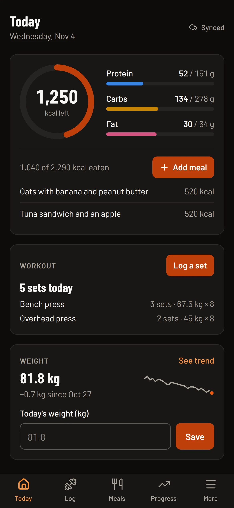
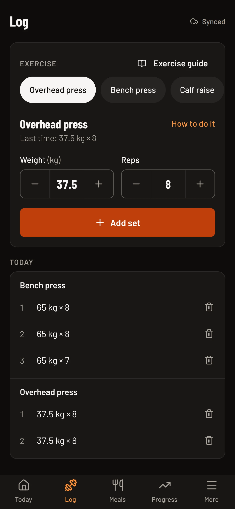
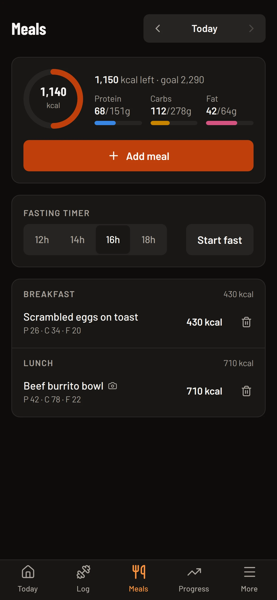
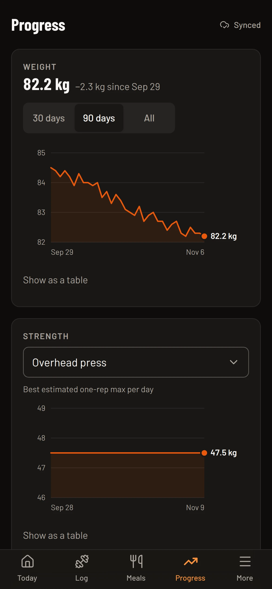
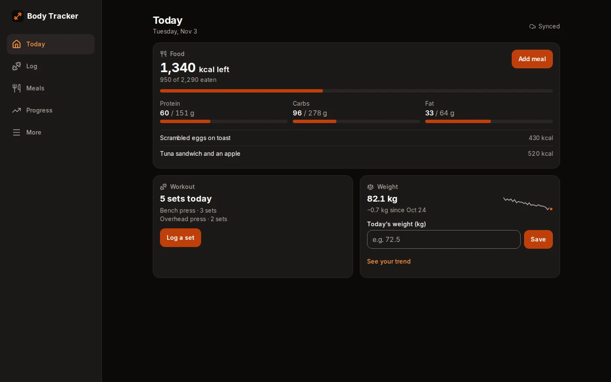

# Body Tracker

Log workouts, meals and your weight from your phone in a few taps, even with
no signal at the gym, and see how you're trending.

**Live:** https://body-tracker-iota.vercel.app · tap **Try it without an account**, no email needed.

<p>
  
  
  
  
</p>



Real screenshots of the app, taken by [`screenshots/capture.ts`](screenshots/capture.ts) (`npm run screenshots`) with a fictional demo account.

## What it does

- **Today** answers "how am I doing today?": calories and macros left, today's
  sets, your weight trend and a running fast.
- **Log** a set in two or three taps: the next set starts as a copy of the
  last one, and **Repeat** logs your last workout again.
- **Meals**: photograph a meal or describe it, and AI (Google's Gemini) fills
  in the numbers. Nothing is saved until you check them and tap Save.
- **Progress**: weight, strength (best estimated one-rep max) and weekly
  volume charts, each with a table view, plus the last 14 days and milestones.
- **Works offline.** Everything is saved on the phone first and syncs when
  you're back online; the app says which is which.
- **Installs like an app** on Android, iPhone and desktop, with light and dark themes.

## Install it

- **Android, or Chrome and Edge on a computer:** open the site and tap
  **Install app** (on Today or in More), or use the install icon in the address bar.
- **iPhone and iPad:** open the site in Safari, tap **Share**, then **Add to Home Screen**.

It then opens in its own window, and pages you've opened before still open with no connection.

## How it works

| Part | Choice |
| --- | --- |
| App | Next.js 16 (App Router), React 19, TypeScript, Tailwind CSS, on Vercel Hobby |
| Sign-in | Supabase Auth: anonymous "try it" accounts, Google, and linking Google to a try-it account so nothing is lost |
| Data | Supabase Postgres with Row Level Security on every table: each row belongs to `auth.uid()` |
| Offline | Dexie (IndexedDB), one database per person; a sync engine pushes local changes and pulls remote ones, with tombstones for deletes |
| PWA | `app/manifest.ts`, a hand-written `public/sw.js` (app shell and static files cached, never API, auth or Supabase calls), `/offline.html` |
| AI | `POST /api/nutrition` calls the Gemini API free tier, behind sign-in and a per-person daily allowance; replies are validated with zod |

The schema lives in [`supabase/migrations`](supabase/migrations).

## Run it locally

Requires Node 22.

```bash
npm install
cp .env.example .env   # fill in your Supabase URL, publishable key and Gemini key
npm run dev            # http://localhost:3000
```

### Set up Supabase (free tier)

1. Create a project at [supabase.com](https://supabase.com) and copy its URL and
   publishable key (Project Settings → API) into `.env`.
2. Apply the schema: `npx supabase login`, `npx supabase link --project-ref <your-ref>`,
   then `npx supabase db push`. In this repo the
   [Database migrations](.github/workflows/migrate.yml) workflow does it on every
   release, with two repository secrets: `SUPABASE_ACCESS_TOKEN` and `SUPABASE_PROJECT_ID`.
3. Authentication → Sign In / Providers: turn on **Allow anonymous sign-ins**
   and **Allow manual linking**, and enable **Google** with a Google Cloud OAuth
   client whose authorized redirect URI is the callback URL shown there. Email
   sign-up can stay off; the app doesn't use it.
4. Authentication → URL Configuration: set the Site URL to your deployment and
   add `http://localhost:3000/**` to the redirect URLs.

## Tests

```bash
npm test             # Vitest: calculations, AI reply parsing, the sync engine
npm run test:e2e     # Playwright against a production build (port 3100)
npm run lint && npm run typecheck
npm run check:ai -- "2 eggs and toast"   # one real Gemini call with your key
npm run test:live                        # the browser tests against the deployed site
```

GitHub Actions runs everything on every push against a throwaway local
Supabase built from the migrations, including a test that proves one person
can't read or change another's rows, and axe accessibility checks of every
screen in both themes. Specs that need sign-in skip locally unless you set
`E2E_SUPABASE=1` with a project that allows anonymous sign-ins.

Measured on the live site on 4 November 2026 (0.4.0): all 16 browser tests
pass against production, and Lighthouse (mobile) scores the welcome screen 93
for performance (median of three runs) and 100 for accessibility, best
practices and SEO.

## Free-tier notes

- **Vercel Hobby** hosts the app; nothing here needs a paid plan or a card.
- **Supabase Free** pauses a project after a week of low database activity.
  The [keep-awake](.github/workflows/keep-awake.yml) workflow makes three light
  calls a day. GitHub disables scheduled workflows in a public repo after 60
  days without commits (and emails first): re-enable it from the Actions tab.
- Try-it accounts and their entries are deleted after 30 days unless saved
  with Google, by a daily `pg_cron` job. Anonymous sign-ups are rate limited
  per IP by Supabase (30 an hour by default).
- **Gemini API free tier**: limits are per key (see your AI Studio rate-limit
  page), and Google may use free-tier inputs to improve its products, which
  the app says next to the photo button. Each person gets 25 estimates a day.
- **GitHub Actions** minutes are free for public repositories.

## Workflow

Gitflow: features merge into `develop` after both test suites pass, releases
merge into `main`, which Vercel deploys. Commits follow Conventional Commits.
